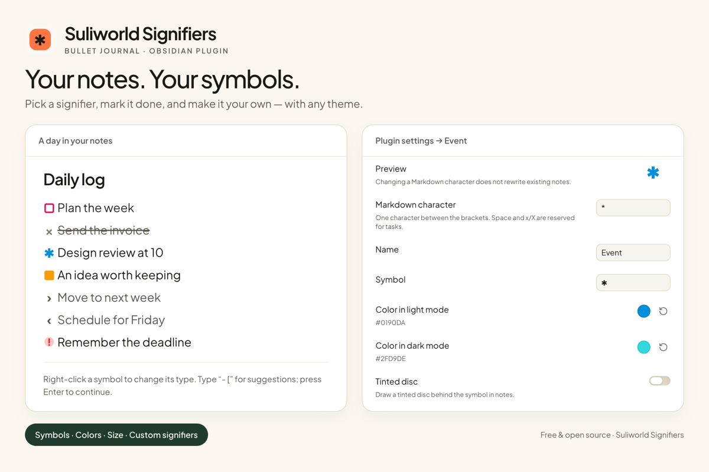
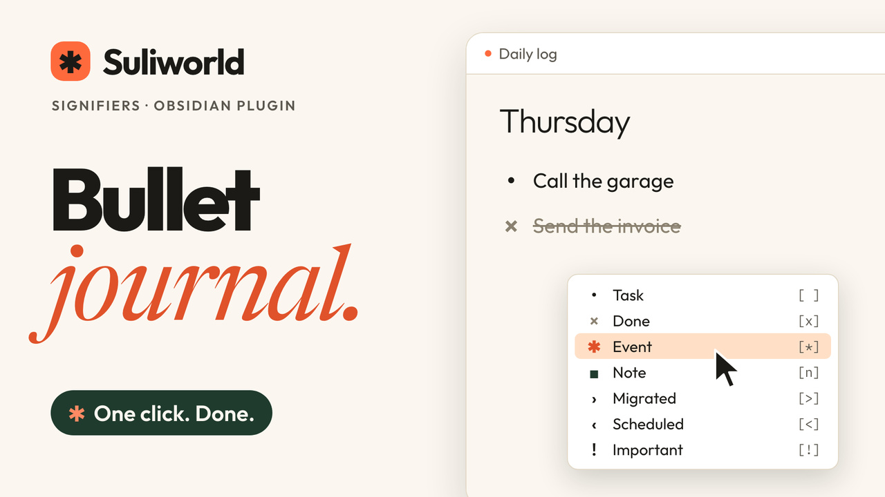

# Suliworld Signifiers

Bullet journal signifiers for [Obsidian](https://obsidian.md) tasks. Works with any theme, and pairs with the [Suliworld theme](https://github.com/sulistef/obsidian-suliworld).



Your notes, your symbols: the preview above shows an example customization. Characters, symbols, colors and size belong to the plugin, independently of the theme.

## Video

See the plugin in action: picking signifiers, marking tasks done, and keeping the same signifier on a new line.

[](https://www.youtube.com/watch?v=4Ah9uRSWrIY)

## Default signifiers

The character between a task's brackets picks its signifier. These are the defaults; customize them or add your own in the plugin settings:

| Markdown | Signifier |
| --- | --- |
| `- [ ]` | • Task |
| `- [x]` | × Done |
| `- [*]` | ✱ Event |
| `- [n]` | ■ Note |
| `- [>]` | › Migrated |
| `- [<]` | ‹ Scheduled |
| `- [!]` | ! Important |

## What it does

- **Defines and draws signifiers** in your notes, with any theme. Configure characters, names, symbols, light/dark colors and size in the plugin settings. Automatic colors follow the active theme’s palette.
- **Click** a signifier to mark it done, and click again to mark it not done. Every signifier behaves the same way.
- **Right-click** (or **long-press** on mobile) a signifier to open a menu: mark done, pick any configured signifier, or turn the line back into a plain bullet. The menu shows the symbols and colors configured in the plugin.
- **Type `- [`** to get a list of signifiers to pick from, instead of typing a character inside the brackets.
- **Press Enter** at the end of an event, a note, or any other signifier to start a new line with the same one. An empty line ends the list. Tasks keep Obsidian's usual behavior.
- **Commands** (assign your own hotkeys): "Set signifier: Event", one per signifier, "Cycle signifier", and "Remove signifier (plain bullet)". They work on every selected line.

Works in Live Preview and in reading view, on desktop and mobile.

## Settings

Open **Settings → Suliworld Signifiers**. No Style Settings plugin or specific theme is required.

- Draw signifiers (on by default), and adjust their size from 0.7 to 1.6 em.
- Keep the signifier on a new line, and suggest signifiers after `- [` (both on by default).
- Open a signifier to edit its Markdown character, name, symbol, light/dark colors and optional tinted disc. Preview the symbol and reset its appearance or individual colors to automatic.
- Add custom signifiers or remove any except the standard Task and Done states. Space and `x`/`X` are reserved; characters must be unique and occupy one UTF-16 code unit (emoji may be used as displayed symbols).

Changing or removing a character does **not** rewrite your notes. Removed or unknown characters keep the active theme’s standard checkbox behavior. Only configured signifiers are handled by the plugin’s interactions. Command IDs remain stable when you change a name or character, preserving hotkeys.

### Migrating from the Suliworld theme

On the first load of the updated plugin, previously saved signifier symbols, light/dark colors, size and enablement are imported from Style Settings. Existing plugin enablement takes precedence. The import is saved in the plugin’s own `data.json` and runs only once; the plugin does not write to Style Settings. Style Settings may remove the obsolete theme options after the theme is updated.

Update the plugin to **1.1.0 or later before updating the Suliworld theme to 1.0.3**. The plugin temporarily suppresses the old theme’s signifier class while enabled, so its own settings apply with either theme version. Updated Suliworld handles only general appearance and uses standard checkboxes when this plugin is disabled.

## Installation

1. In Obsidian, open **Settings → Community plugins → Browse**.
2. Search for **Suliworld Signifiers** and select **Install**.
3. Select **Enable**, then open **Settings → Suliworld Signifiers** to customize it.

### Manual installation

1. Download `main.js`, `manifest.json`, and `styles.css` from the [latest release](https://github.com/sulistef/obsidian-suliworld-signifiers/releases/latest).
2. Put them in your vault, in `.obsidian/plugins/suliworld-signifiers/`.
3. In Obsidian, go to Settings → Community plugins, and turn on Suliworld Signifiers.

## Development

The plugin is written in TypeScript (`src/`) and bundled with esbuild into `main.js`.

```bash
npm install
npm run dev     # rebuild main.js on every change
npm run build   # type-check (strict) and build for production
npm test        # configuration, migration, CSS escaping and Markdown checks
npm run lint    # ESLint with Obsidian's official rules (eslint-plugin-obsidianmd)
```

To try it in a vault, copy `main.js`, `manifest.json`, and `styles.css` into `.obsidian/plugins/suliworld-signifiers/`.

## Releasing

Run `npm version patch` (or `minor`, `major`): it updates `manifest.json` and `versions.json`. Push the commit and the tag. The release workflow lints, tests, builds, and attaches `main.js`, `manifest.json`, and `styles.css` to a GitHub release.

Presentation assets for the README and community directory are in [images/](images/README.md).

## Changelog

### 1.1.0

- Manage all signifier definitions and appearance in the plugin: characters, names, symbols, light/dark colors, size and optional tinted discs.
- Add or remove custom signifiers; menus, suggestions and commands follow your settings. Command IDs stay stable when names or characters change.
- Import saved Suliworld signifier appearance from Style Settings once. Install this plugin update before Suliworld theme 1.0.3 to preserve those customizations.
- Draw configured signifiers with any theme, including in popout windows, and preview them in plugin settings.
- Add a visual overview, a dedicated video and current community-plugin installation instructions.

## License

[MIT](LICENSE)
